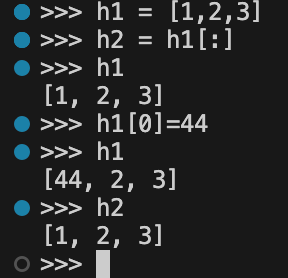

# DataTypes in Python :

1. Integers
2. Floats
3. Strings
4. Complex numbers
5. Lists
6. Tuples
7. Sets
8. Dictionaries

Numbers : 1234 , 3.14 , 1+2j
Strings : "Hello World" , 'Hello World' , """Hello World""" , "Bob's", u'Unicode', b'Bytes' 

Boolean : True , False , 0 , 1

Lists : [1 , 34 , [2,563,26,45], True , "Hello" , ("a" , 23 , False)] , list(range(10)) , list("Hello")

Tuples : (1 , 34 , [2,563,26,45], True , "Hello" , ("a" , 23 , False)) , tuple(range(10)) , tuple("Hello")

Dictornary : {"food" : "life" , "price" : 200} , dict(hours = 10 , minutes = 30 , sec = 40) , dict("key1" , "key2")

Set (unique values) : {1 , 2 , 3 , 1 , 2 , 4 , 5} 

Files : f = open("example.txt" , "r") , f = open("example.txt" , "w") , f = open("example.txt" , "a") 

None : None 

Functions , modules , classes 

Advance : Decorators , Generators , iterators , Metaprogramming 

---

## List Slicing & Memory References (Shallow Copy)

When slicing a list using `[:]`, Python creates a **new copy in memory** instead of referencing the original list object. Because `h2` points to its own separate memory block, changing elements in `h1` does not affect `h2`.

```python
>>> h1 = [1, 2, 3]
>>> h2 = h1[:]       # Slicing creates a new copy in memory
>>> h1
[1, 2, 3]
>>> h1[0] = 44       # Modifying h1
>>> h1
[44, 2, 3]
>>> h2               # Value of h2 remains unchanged
[1, 2, 3]
```



### Key Takeaway:
- **`h2 = h1` (Direct assignment):** Copies the **reference**. Both variables point to the same memory location, so mutating one affects both.
- **`h2 = h1[:]` (Slicing):** Creates a **new memory block** (shallow copy). Slicing doesn't use the original reference, hence the value of `h2` remains the same even after changing `h1`.


