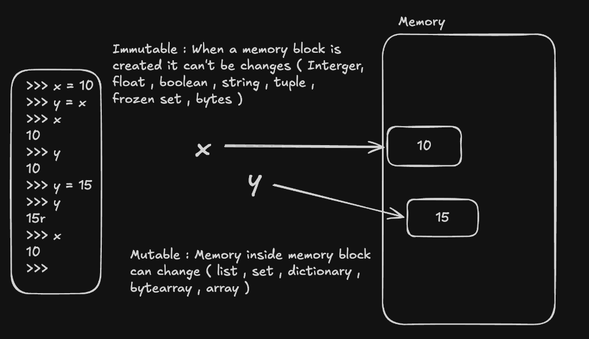

# Python Hands-on

## Python Execution Architecture & Bytecode


### Notes:
- **Compile to bytecode:** Low level & platform independent.
- **Python Virtual Machine (VM):** Executes the compiled bytecode.
- **Performance:** Bytecode runs faster.
- **`.pyc`:** Compiled Python (frozen binaries).
- **`__pycache__`:** Manages bytecode based on source changes and Python version.
  - Works only for imported files.
  - Not generated for top-level executed scripts.

# Python Virtual Machine  

Code loops to iterate bytecode 
Runtime Engine 
Also know as python Interpreter 

Byte Code is not a Machine code 

Python specific interpretation 
cpython ( standard implementation ) , jython ( java platform ) , Iron python ( .NET platform ) , stackless ( lightweight threads ) , pypy ( just in time compilation ) 

## Mutable vs Immutable & Memory Allocation



### Notes:
- **Immutable:** When a memory block is created, it cannot be changed (e.g., Integer, Float, Boolean, String, Tuple, Frozen Set, Bytes).
- **Mutable:** Memory inside the memory block can change (e.g., List, Set, Dictionary, Bytearray, Array).
- **Reference assignment:** Variables point to references in memory rather than containing values directly. When reassigned (e.g., `y = 15`), the variable references a new memory block.

---

## Python Memory Model: Variables vs. Objects

> **Core Rule to Remember:**  
> **Python *has* data types (and is strongly typed), but Python *variables* do not have data types.**  
> Types live on the **objects in heap memory**, never on the variable names.

### 1. Variables vs. Objects in Memory

- **In Statically Typed Languages (Java, C++, C#):**  
  A variable is like a rigid, labeled box (`int x = 10;`). The box itself has a fixed type and can only ever hold that specific type.
  
- **In Python:**  
  A variable is simply a **name tag (reference / pointer)** bound to an object in heap memory:
  - When executing `x = 10`: Python allocates an `int` object with value `10` in heap memory, then attaches the label `x` to point to it.
  - When subsequently executing `x = "hello"`: You are not changing the type of `x`. Python creates a new `str` object `"hello"` in memory and moves the `x` label over to point to the new object. The old `int` object (if unreferenced) is cleaned up by garbage collection.

| Feature | Statically Typed (Java, C++) | Python |
| :--- | :--- | :--- |
| **Variable Concept** | Fixed container / typed box | Name tag / Reference pointing to an object |
| **Where Type Resides** | On the variable declaration | Inside the object header in heap memory |
| **Type Binding** | Compile time | Runtime (Dynamic) |

> **Common Misconception:** Saying *"Python does not have data types"* is false. Python has built-in data types (`int`, `str`, `list`, `dict`, etc.) and enforces strict type safety at runtime.

---

### 2. Dynamically Typed vs. Strongly Typed

Python is **both** dynamically typed and strongly typed:

1. **Dynamically Typed:**  
   Variable names have no fixed types. Type checking happens at **runtime** based on whichever object the variable currently references.
2. **Strongly Typed:**  
   Python **strictly enforces type safety** and will not implicitly coerce incompatible types.
   ```python
   # Raises TypeError (no implicit type coercion)
   result = "5" + 5  # TypeError: can only concatenate str (not "int") to str
   ```
   *(Contrast with weakly typed languages like JavaScript, where `"5" + 5` silently becomes `"55"`).*

---

### 3. Interview Cheat Sheet & Common Questions

#### Q1: "Python is both dynamically typed and strongly typed. What does that mean?"
- **Answer:**  
  - **Dynamic typing** means variable names do not have fixed types; type checking happens at runtime based on the object currently referenced.
  - **Strong typing** means Python enforces operations according to object types and never performs implicit type coercion (e.g., adding a string to an integer raises a `TypeError`).

#### Q2: The Reference Trap (Shared References)
**Code snippet:**
```python
a = [1, 2, 3]
b = a
b.append(4)

print(a)  # Output: [1, 2, 3, 4]
```
- **Why Interviewers Ask This:**  
  Both `a` and `b` are references pointing to the **exact same list object** in heap memory. Modifying the list via `b` mutates the shared object in place, so inspecting `a` reflects that change.

#### Q3: "Why don't we declare variable types in Python like in Java or TypeScript?"
- **Answer:**  
  Because variables in Python are merely untyped references (pointers) stored in the symbol table. The type metadata is stored inside the object header on the heap (`PyObject`), not on the variable itself.

