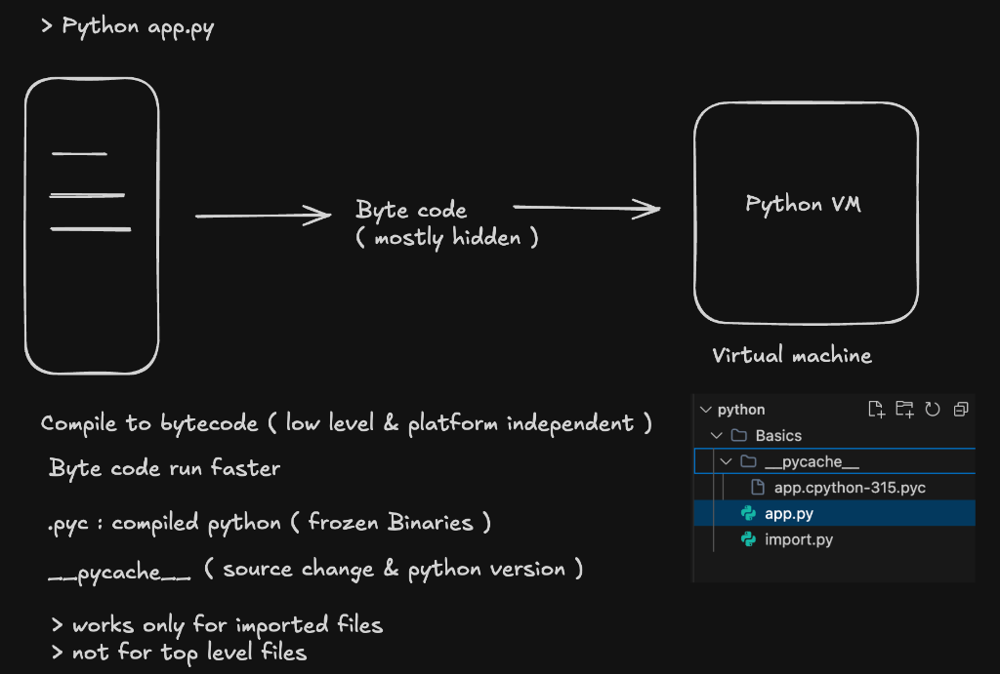

# Python Hands-on

## Python Execution Architecture & Bytecode

### Notes:
- **Compile to bytecode:** Low level & platform independent.
- **Python Virtual Machine (VM):** Executes the compiled bytecode.
- **Performance:** Bytecode runs faster.
- **`.pyc`:** Compiled Python (frozen binaries).
- **`__pycache__`:** Manages bytecode based on source changes and Python version.
  - Works only for imported files.
  - Not generated for top-level executed scripts.

# Python Virtual Machine  

Code loops to iterate bytecode 
Runtime Engine 
Also know as python Interpreter 

Byte Code is not a Machine code 

Python specific interpretation 
cpython ( standard implementation ) , jython ( java platform ) , Iron python ( .NET platform ) , stackless ( lightweight threads ) , pypy ( just in time compilation ) 

## Mutable vs Immutable & Memory Allocation

### Notes:
- **Immutable:** When a memory block is created, it cannot be changed (e.g., Integer, Float, Boolean, String, Tuple, Frozen Set, Bytes).
- **Mutable:** Memory inside the memory block can change (e.g., List, Set, Dictionary, Bytearray, Array).
- **Reference assignment:** Variables point to references in memory rather than containing values directly. When reassigned (e.g., `y = 15`), the variable references a new memory block.
